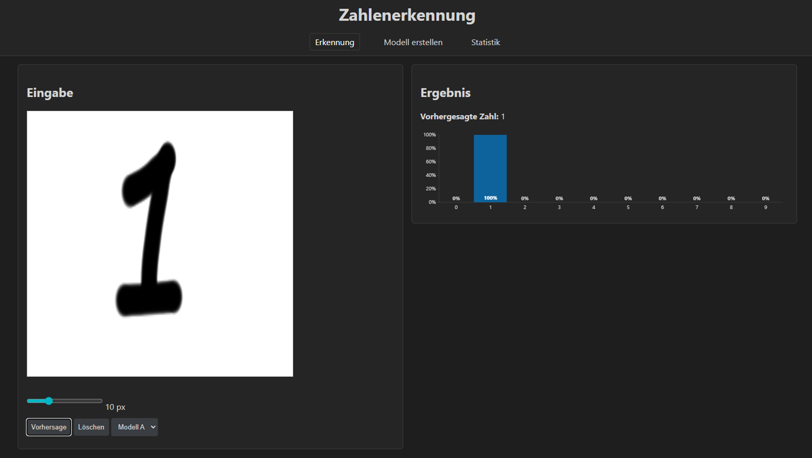

# MNIST_AI

Neuronales Netz **von Grund auf in NumPy** (ohne TensorFlow/PyTorch), das handgeschriebene Ziffern erkennt, dazu eine kleine Webapp zum Ausprobieren und eine Experiment-Reihe zum Vergleich von Aktivierungsfunktionen.



## Warum?

Frameworks nehmen die Mathematik ab. Ziel dieses Projekts war es, zu verstehen, was in einem neuronalen Netz wirklich passiert. Deshalb wurden Schichten, Aktivierungsfunktionen, Backpropagation und Optimierer selbst implementiert. Die Webapp macht das Ergebnis direkt testbar: Ziffer zeichnen, Wahrscheinlichkeiten pro Ziffer ablesen.

## Features

- **Eigenes Netz in NumPy** (`network/`)
  - Dense-Schichten mit Forward- und Backward-Pass
  - Aktivierungen: Linear, ReLU, LeakyReLU, ELU, Tanh, Softmax
  - Loss: Categorical Crossentropy
  - Optimierer: einfaches Gradientenverfahren und Adam
  - Speichern und Laden trainierter Netze als CSV
- **Webapp** (Flask + TypeScript)
  - Ziffer auf einer Zeichenfläche malen (einstellbare Pinselgröße)
  - Vorhersage mit Wahrscheinlichkeiten für alle Ziffern 0–9 als Balkendiagramm
- **Experimente** (`main.py`): 29 Konfigurationen × 5 Durchläufe, Ergebnisse in `logs/`

## Vorverarbeitung der Zeichnung

Zeichnungen sehen anders aus als MNIST-Bilder. Damit das Netz sie trotzdem erkennt, passiert vor der Vorhersage auf dem Server Folgendes:

1. Umwandlung in Graustufen, Invertierung (MNIST: heller Strich auf dunklem Grund)
2. Zuschneiden eng um den Strich, mit Rand, und Skalieren auf 28×28
3. Zentrieren über den Schwerpunkt des Strichs
4. Leichte Glättung (Gauß-Filter)

## Experimente

Verglichen wurden vier Aktivierungsfunktionen (plus eine lineare Baseline) in verschiedenen Szenarien: Standard, hohe Lernrate, kurzes und langes Training, kleiner Datensatz, tiefes und breites Netz. Jede Konfiguration wurde fünfmal trainiert, die Tabelle zeigt Mittelwert und Standardabweichung auf dem Testset.

| Szenario (Architektur `[128, 64]`) | ReLU    | LeakyReLU | ELU     | Tanh    |
| ---------------------------------- | ------- | --------- | ------- | ------- |
| Baseline                           | 97,83 % | 97,67 %   | 97,58 % | 97,57 % |
| Hohe Lernrate (0,01)               | 96,61 % | 96,98 %   | 96,04 % | 95,39 % |

Ohne Aktivierungsfunktion (linear) sind es nur **91,35 %**, Nichtlinearität ist also entscheidend. Das beste Einzelergebnis erreichte ELU mit tiefer Architektur: **98,06 % (±0,05 %)**. Weitere Ergebnisse und die Auswertung stehen in `logs/`.

## Installation

Voraussetzung: Python 3.12

```bash
pip install -r requirements.txt
```

## Webapp starten

```bash
python -m root.backend.server
```

Dann im Browser `http://localhost:8000` öffnen. Die Webapp braucht nur das trainierte Netz `MNIST/network0.csv`, das im Repo liegt.

Das Frontend ist bereits nach JavaScript übersetzt. Nur für Änderungen am TypeScript-Code in `root/frontend/src`:

```bash
npm install -g typescript
tsc -p root/frontend --watch
```

## Netz selbst trainieren

Die MNIST-Dateien `mnist_train.csv` und `mnist_test.csv` (Quelle: siehe `MNIST/README.md`) in den Ordner `MNIST/` legen. Dann:

```bash
python main.py
```

Das trainiert das Netz der Webapp (784 → 128 → 128 → 64 → 10, ReLU und Softmax, Adam) und überschreibt `MNIST/network0.csv`. Die große Experiment-Reihe lässt sich in `main.py` über `run_experiments()` starten und dauert viele Stunden.

## Projektstruktur

```
network/        Netz: Schichten, Aktivierungen, Loss, Optimierer, Training, CSV-Import/Export
root/backend/   Flask-Server mit Vorverarbeitung und /predict
root/frontend/  Weboberfläche (TypeScript in src/, übersetzt nach public/)
MNIST/          trainiertes Netz (network0.csv), Datensätze kommen hierhin
logs/           Ergebnisse und Auswertung der Experimente
main.py         Training und Experimente
```

## Status

- **Erkennung:** funktioniert
- **Modell erstellen** und **Statistik:** Platzhalter-Seiten, noch nicht umgesetzt
- Die Webapp ist für lokale Nutzung gedacht, nicht für den öffentlichen Betrieb

## Technik

Python · NumPy · SciPy · Flask · Pillow · TypeScript

## Lizenz

MIT, siehe `LICENSE`. Die MNIST-Daten haben ihre eigene Lizenz (`MNIST/LICENSE.txt`).

## Autor

Matthrose
